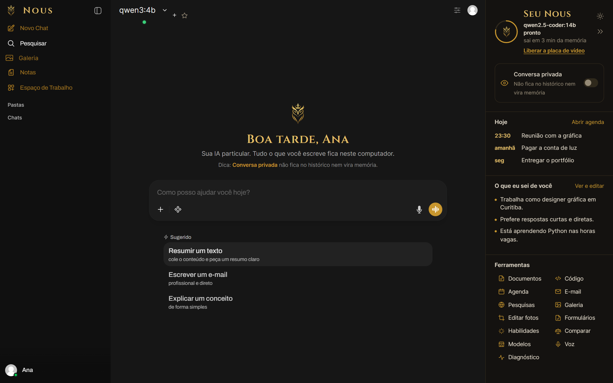
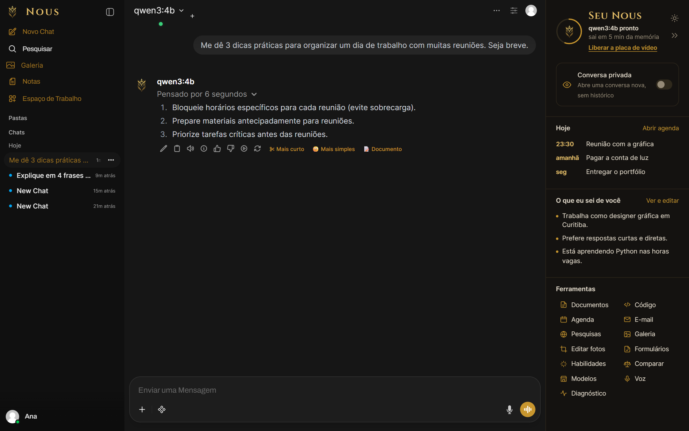
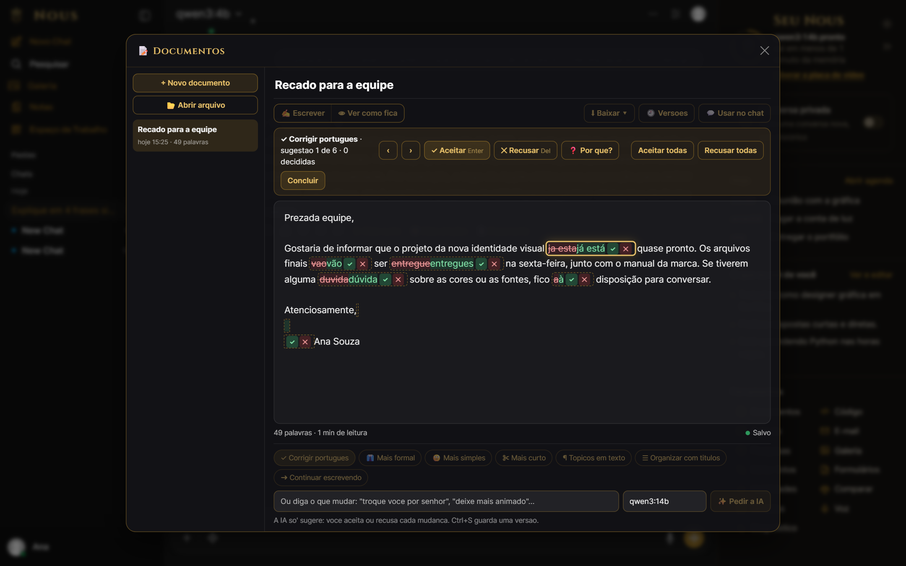
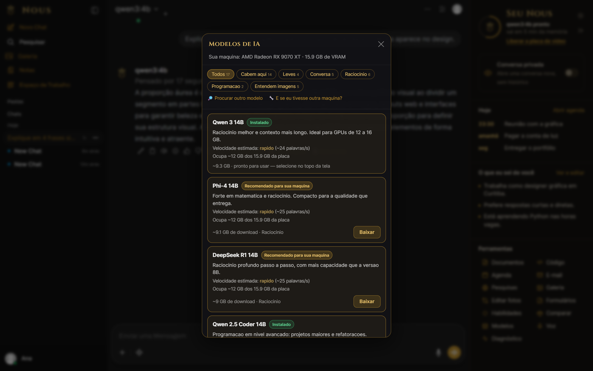
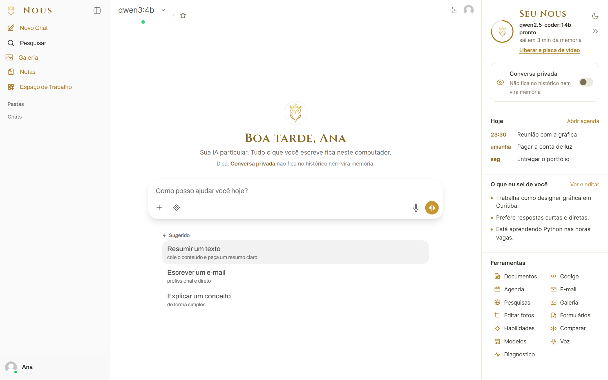
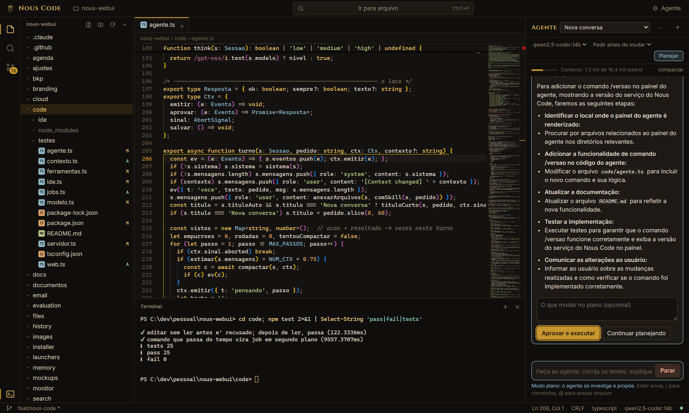
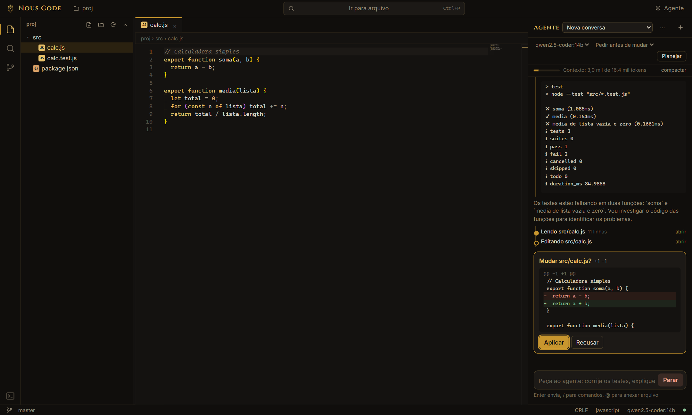

<div align="center">


# Nous

**Your private AI, running on your own computer.**

Chat, documents, calendar, email, research and coding with local AI on Windows.<br>
No cloud, no subscription, no account to create.

[](CHANGELOG.md)
[](LICENSE)
[](#requirements)
[](#privacy-and-security)
[](https://github.com/Guilhermecmt/Nous-Webui/actions)

**English** · [Português](README.pt-BR.md)

[Install](#installation) · [Features](#features) · [Nous Code](#nous-code) · [Privacy](#privacy-and-security) · [Development](#for-developers)



</div>

> The Nous interface is in Brazilian Portuguese. The screenshots and the labels quoted below (in *italics*) are the actual Portuguese UI.

## Overview

**Nous** (Greek *νοῦς*, "mind") turns [Open WebUI](https://github.com/open-webui/open-webui) and [Ollama](https://ollama.com) into a finished product for non-technical people. It installs in two clicks, picks the right model for your hardware and runs everything in the background, without terminal windows.

- **Private by default.** The model runs on your machine, the server only accepts connections from the PC itself, and chats, memories and files stay on your disk.
- **Ready to use.** No account, API key or configuration. On first launch, a wizard recommends and downloads the best model for your graphics card.
- **More than a chat.** It remembers you, reads your notes, writes documents with you, manages your calendar and email, researches the web with sources and codes with a real agent.
- **Built for local models.** Every feature was tested with small models (4B to 14B) on a consumer GPU, not only with cloud models.

## Gallery

<table>
<tr>
<td width="50%"><br><sub><b>Chat.</b> Every reply has "shorter", "simpler" and "document" actions. The right panel shows the GPU, your agenda and what Nous knows about you.</sub></td>
<td width="50%"><br><sub><b>Documents.</b> The AI only suggests: each change appears struck through and underlined, and you accept or reject them one by one.</sub></td>
</tr>
<tr>
<td width="50%"><br><sub><b>Model store.</b> Recommends what runs well on your GPU, shows the estimated speed and downloads in one click.</sub></td>
<td width="50%"><br><sub><b>Light theme.</b> White and gold, with the same home screen and panel.</sub></td>
</tr>
</table>

## Nous Code

An IDE with a coding agent that uses only local AI, in its own window. It brings together the VS Code editor (Monaco), files, search, Git and a real terminal, with an agent alongside that reads your project, proposes a plan, edits and runs the tests. Every change goes through your approval. The agent harness adapts the open-source [DeepSeek Harness](https://github.com/deepseek-ai/deepseek-harness) (MIT): the same tools, prompts and policies, tuned for a 14B local model.



| In the editor | In the agent |
|---|---|
| Monaco, tabs, minimap, Ctrl+S | Reads, searches (`glob`, `grep`), navigates code with a language server (`lsp`), edits and runs commands |
| File tree with create, rename and delete (to the Recycle Bin) | **Plan mode** (`/plano`): investigates without touching anything and proposes a plan for you to approve |
| **Ctrl+P** to open a file and **Ctrl+Shift+F** to search the project | **Permissions** in four levels, from read-only to full access |
| Git: changed files, side-by-side diff, commit and discard | Diff on screen before every change, and **Undo** per file or for everything |
| Real PowerShell terminal (ConPTY), with **Ctrl+`** | Task list, multiple-choice questions and a **goal** (`/objetivo`) it keeps working on, round after round, until done |
| Reloads a file when the agent changes it on disk | Long commands become background jobs, and the agent is told when they finish |
| **Ctrl+L** asks the agent about the selected code | **Reminders** ("remind me tomorrow at 9 to run the tests") that run the conversation on their own |
| | **MCP servers** (`.mcp.json`, the Claude Code format), internet with permission, delivered files |
| | Context compaction, research subagent, skills (`SKILL.md`) and `@file` |
| | Ollama, plus **LM Studio**, llama.cpp or vLLM through the OpenAI-compatible API |



**Built for small models.** The engine makes up for the usual habits of local models:
- It reads tool calls written as JSON in the text. `qwen2.5-coder:14b`, for example, never uses Ollama's native channel.
- It only lets the agent edit a file after reading it, and refuses the edit if the file changed since then.
- It accepts snippets copied with line numbers or with different indentation.
- It warns when the model repeats the same call (3rd, 5th and 8th time) and stops after ten identical results.
- It summarizes the conversation before the context overflows.

**How to open it:**
- from the **Nous Code** shortcut;
- from *Código* in the panel;
- by typing *"abre o código"* in the chat.

Requires [Node.js](https://nodejs.org) 22.18 or newer (`winget install OpenJS.NodeJS.LTS`). When Node is present, the installer downloads the editor and creates the shortcut. Technical details are in [`code/README.md`](code/README.md).

## What's new in 2.10

- **No login.** Nous opens straight into the chat, like any other program. Your account and past conversations are kept. With two or more accounts on the same PC, the login screen comes back on its own.
- **"Seu Nous" panel.** The owl inside a ring shows GPU usage, and the panel gathers the private chat, upcoming reminders, what Nous knows about you and every tool.
- **Nous Code.** The local-AI IDE described above.
- **Private chat.** Not kept in history and never turned into memory.

The full history is in the [CHANGELOG](CHANGELOG.md) (in Portuguese).

## Requirements

| | Minimum | Recommended |
|---|---|---|
| System | Windows 10 or 11 | Windows 11 |
| RAM | 8 GB | 16 GB or more |
| Graphics card | None: runs on the CPU | 8 GB of VRAM or more |
| Free disk | 20 GB | 30 GB or more |
| Nous Code (optional) | Node.js 22.18 | Current Node.js LTS |

Without a dedicated GPU, Nous runs on the CPU and answers simply take longer. The model store detects this and recommends light models.

## Installation

1. Use **Code → Download ZIP** at the top of this page and unzip it anywhere.
2. **Double-click `instalar.bat`**. If Windows warns you, choose **More info → Run anyway**.

The installer:
- checks your hardware;
- installs Ollama, Python 3.11 and the interface, without touching what is already on the machine;
- applies the Nous identity;
- creates shortcuts on the desktop and in the Start menu.

Nous opens in your browser when it finishes. It lives in `%LOCALAPPDATA%\Programs\Nous`, so the downloaded folder can be deleted. If a step fails, the installer shows the reason in red instead of saying "Pronto!".

## First run

1. **Open it.** There is no account or password: Nous opens straight into the chat.
2. **Pick a model.** With no model installed, a welcome screen shows the one recommended for your computer. *Baixar e começar* handles the rest, with a progress bar.
3. **Chat.** When the download finishes, just type.

If several people share the computer, create one account each in **Admin Panel › Users**. With two or more accounts the login screen returns, and each person sees only their own chats.

## Features

### The "Seu Nous" panel

A panel fixed on the right brings together what matters:
- the GPU, in a ring around the owl that turns gold when a model is loaded, with a button to free the GPU;
- the private chat;
- upcoming reminders;
- what Nous knows about you;
- the tools: Documents, Code, Calendar, Email, Research, Gallery, Photo editor, PDF forms, Skills, Compare, Models, Voice and Diagnostics.

On smaller screens it becomes a drawer. When closed, only the owl remains in the corner.

### AI models

Open the store from **Ferramentas › Modelos**. It shows:
- a catalog with a "recommended for your machine" badge;
- the estimated speed on your GPU;
- how much video memory each model uses;
- an "understands images" badge on vision models.

| Your machine | Suggested model | Download | Profile |
|---|---|---|---|
| No dedicated GPU | Qwen 3.5 4B | ~3.4 GB | Light, fast on CPU, understands images |
| 8 to 12 GB GPU | Gemma 4 12B | ~7.6 GB | Chat, writing and vision |
| 12 to 16 GB GPU | Qwen 3 14B | ~9.3 GB | Better reasoning and longer context |
| 20 GB GPU or more | Qwen 3 32B | ~20 GB | Close to large cloud models |

**Other model** accepts any Ollama name or Hugging Face (GGUF) link. Nous reads the size from the registry, without downloading anything, and tells you whether it fits your GPU and disk before offering the download. *E se eu tivesse outra máquina?* simulates another GPU and shows what would run.

### Memory

While you chat, Nous keeps durable facts (name, city, job, preferences) and uses them in later conversations. From the panel you can:
- view, edit, pin and delete each memory;
- create personas with separate memories;
- merge duplicates;
- **import** facts from a résumé, an "about me" text or your ChatGPT memories, choosing what to keep;
- **export** everything as a backup.

### Documents

Write letters, résumés and papers next to the chat, or open a `.docx`, `.pdf`, `.txt` or `.md`.

**Ready-made requests:**
- fix the Portuguese
- more formal
- simpler
- shorter
- bullets into prose
- organize with headings
- keep writing

**How the review works:** the AI never writes into the text. Each change shows up struck through and underlined, with the text arriving live, and you accept or reject it. "Why?" explains each suggestion, and selecting a passage limits the change to it.

Documents save themselves, keep versions (with a comparison before restoring) and download as **Word, PDF or Markdown**.

### Calendar, reminders and tasks

*"Me lembre de pagar a luz sexta às 9h"* ("remind me to pay the power bill Friday at 9") becomes a Windows notification at the right time, even with the browser closed. The calendar has:
- notes with checklists;
- a calendar with `.ics` import and Google Calendar, Outlook or iCloud subscriptions;
- reminders on your phone (ntfy) or by email;
- **scheduled tasks**, such as a daily morning briefing with the agenda and emails, that run on their own and can chain into each other.

Dates and times are parsed by rules, not guessed by the model.

### Email (optional)

Connect one or more Gmail, Outlook or Yahoo accounts with an app password. Nous:
- sorts mail into important, can wait, promotion and spam;
- summarizes messages and attachments;
- drafts replies;
- learns your contacts;
- writes emails from the chat.

It never sends without your confirmation, and emails only go through the local model.

### Deep Research

Pick **Pesquisa Profunda (Nous)** in the model selector. Nous:
1. plans sub-questions;
2. searches the web (local SearXNG);
3. reads the pages;
4. delivers a report with numbered citations and a source list.

Reports are kept in the panel, download as PDF or Word, and the conversation can continue from them.

### More features

- **Files:** anything you put in `Documents\Nous`, or your Obsidian vault, is searched before each answer, using multilingual embeddings.
- **Skills:** say *"aprenda isso"* ("learn this") and Nous keeps the steps for similar requests, including your writing style.
- **Compare models:** the same question to 2 to 4 models, a blind vote and a leaderboard.
- **Images and bills:** local OCR, even with models without vision. Brazilian bank slips come out with bank, amount and due date, checked.
- **PDF forms:** filled in and signed.
- **Photo editor and gallery:** crop, adjust, remove the background with local AI, or describe the edit in plain words.
- **Image generation (optional):** ComfyUI with Flux.1 Schnell.
- **Voice in Portuguese (optional):** local Piper and Whisper, with a hands-free conversation mode.
- **Chat utilities:** YouTube summaries, weather, and commands like *"tema escuro"* (dark theme) or freeing the GPU.
- **Nous Cloud (optional):** frontier models through NVIDIA's free API, without sending your personal memory.
- **Diagnostics:** every part of Nous with ✓ or ✗ and what to do, plus on-screen privacy (sensitive numbers and keys are blurred) and the first-run tips.

## Privacy and security

- **Everything local.** Models run on your machine's Ollama. Chats, memories, documents and indexes live in `%USERPROFILE%\NousData`.
- **This PC only.** The Nous server and every service listen only on `127.0.0.1`, so other devices on the network cannot reach them. The services reject pages from other websites.
- **No login, by choice.** Since nobody outside can reach Nous, your Windows password is what protects the data. To require a login anyway, create an empty file `NousData\.exigir_login`.
- **Nothing leaves unless you ask.** Web search, NVIDIA cloud and email are optional, and your personal memory is never sent to cloud models.
- **An agent under control.** Nous Code only touches the chosen project folder. Changes and commands ask for approval, internet access asks once per conversation, and everything it changes can be undone.

## Troubleshooting

<details>
<summary><b>"Windows protected your PC"</b></summary>

The standard warning for unsigned programs. Click **More info → Run anyway**.
</details>

<details>
<summary><b>The desktop shortcut did not appear</b></summary>

Some antivirus programs block shortcuts. Press the Windows key and type **Nous**: the Start menu shortcut is always created. You can also double-click `iniciar.bat` in `%LOCALAPPDATA%\Programs\Nous`.
</details>

<details>
<summary><b>"Open WebUI" shows instead of Nous</b></summary>

Open Nous from the shortcut and press **Ctrl+Shift+R** in the browser. The identity is checked and reapplied on every start.
</details>

<details>
<summary><b>The chat does not answer</b></summary>

Open Nous from the shortcut, which starts every service. If it persists, free the GPU from the panel and try again. **Diagnostics** shows what is stopped.
</details>

<details>
<summary><b>Nous Code does not open</b></summary>

Install Node.js (`winget install OpenJS.NodeJS.LTS`) and run `instalar.bat` again: it downloads the editor and creates the **Nous Code** shortcut.
</details>

<details>
<summary><b>I want the login screen back</b></summary>

Create an empty file named `.exigir_login` in `%USERPROFILE%\NousData` and open Nous again. Your account goes back to its previous email and password. Delete the file to remove the login again.
</details>

## Uninstall

In **Settings → Apps → Installed apps**, find **Nous** and click **Uninstall**:
- **Safe removal** (recommended) removes the app and its Python environment and keeps your chats, notes, Ollama and Python.
- **Remove everything** also deletes the data and uninstalls Ollama and Python, but only if Nous installed them.

## For developers

### Architecture

Nous is a product layer over Open WebUI 0.9.6 (pinned in the installer). It combines three parts:
- a visual identity injected by a `loader.js` with the panels;
- filters and pipes registered in the database;
- small local services, all on `127.0.0.1`.

| Port | Service | Folder |
|---|---|---|
| 8080 | Open WebUI with the Nous identity | `branding/`, `ajustes/` |
| 8990 | Monitor: model store, diagnostics, documents, gallery, editor, PDF forms, compare, reports | `monitor/`, `documentos/` |
| 8991, 8992 | File and chat-history indexers | `files/`, `history/` |
| 8993 | Memory and personas | `memory/` |
| 8994 | Voice (Piper) | `voice/` |
| 8995 | Email | `email/` |
| 8996 | Calendar, reminders and tasks | `agenda/` |
| 8997 | Skills | `skills/` |
| 8998 | Nous Code (IDE and agent, Node) | `code/` |
| 8188 | ComfyUI (optional) | `images/` |
| 11434 | Ollama | |

The launcher (`launchers/start-nous.ps1`) starts everything hidden and registers filters and settings on every start. Every step is idempotent: running it again breaks nothing.

### Layout

```
branding/    identity, loader.js and panel modules (branding/modules)
code/        Nous Code: agent (agente.ts), tools, server and the IDE (code/ide)
monitor/     model store, diagnostics and panel APIs
memory/      personal memory: filter, API and personas
documentos/  Documents (suggestions, versions, Word/PDF) and PDF forms
agenda/      notes, reminders, calendar and scheduled tasks
email/       IMAP/SMTP client and API
search/      web search and Deep Research
skills/      skills
utilidades/  chat filters: YouTube, weather, OCR, compaction, commands
files/       search over your files
history/     search over past chats
images/      ComfyUI, Flux and the image pipe
voice/       Portuguese voice
cloud/       Nous Cloud (NVIDIA NIM)
ajustes/     Open WebUI defaults and login-free access
evaluation/  model comparison
installer/   installer, uninstaller and Inno Setup
launchers/   background start and stop
tools/       lint, health check, backup, hardware check
```

### Tests and lint

```powershell
tools\lint.ps1            # PowerShell 5.1, Python, JSON, JavaScript, plus Nous Code types and tests
cd code; npm install; npm test
```

Lint runs in CI on every push. The Nous Code tests use a fake Ollama server to check the agent policies without a real model.

### Command-line install

```powershell
powershell -ExecutionPolicy Bypass -File installer\install-nous.ps1 -WithModel -Model qwen3:14b
```

`-WithImages` also installs the image engine and `-Force` reinstalls. The `.exe` installer is built from `installer\nous-setup.iss` with `ISCC.exe`.

Each service documents its routes at the top of its file, for example `monitor/nous_monitor.py`, `agenda/nous_agenda_api.py` and `code/servidor.ts`.

## Roadmap and contributing

Next steps are in the [ROADMAP](docs/ROADMAP.md). Issues and pull requests are welcome: see [CONTRIBUTING](CONTRIBUTING.md).

## Built on

**Foundation:**
- [Open WebUI](https://github.com/open-webui/open-webui)
- [Ollama](https://ollama.com)
- [Monaco Editor](https://github.com/microsoft/monaco-editor) (MIT)
- [xterm.js](https://github.com/xtermjs/xterm.js) (MIT)
- [node-pty](https://github.com/microsoft/node-pty) (MIT)
- [DeepSeek Harness](https://github.com/deepseek-ai/deepseek-harness) (MIT): the Nous Code agent adapts its tool contract, prompts and policies ([details](code/THIRD_PARTY_NOTICES.md))
- [typescript-language-server](https://github.com/typescript-language-server/typescript-language-server) (Apache-2.0) and [Pyright](https://github.com/microsoft/pyright) (MIT), for code navigation

**Models and libraries:**
- [ComfyUI](https://github.com/comfyanonymous/ComfyUI)
- [Flux.1 Schnell](https://huggingface.co/black-forest-labs/FLUX.1-schnell) (Apache-2.0)
- [U²-Net](https://github.com/xuebinqin/U-2-Net) (Apache-2.0, model published by [rembg](https://github.com/danielgatis/rembg))
- [RapidOCR](https://github.com/RapidAI/RapidOCR) (Apache-2.0)
- [pypdf](https://github.com/py-pdf/pypdf) (BSD-3)
- [Granite Embedding](https://huggingface.co/ibm-granite/granite-embedding-278m-multilingual) (Apache-2.0)

**Services:**
- [ntfy](https://ntfy.sh)
- [Open-Meteo](https://open-meteo.com)

The model store's speed estimate was inspired by [llmfit](https://github.com/AlexsJones/llmfit) (MIT). Trademarks belong to their respective projects.

## License

[MIT](LICENSE)
